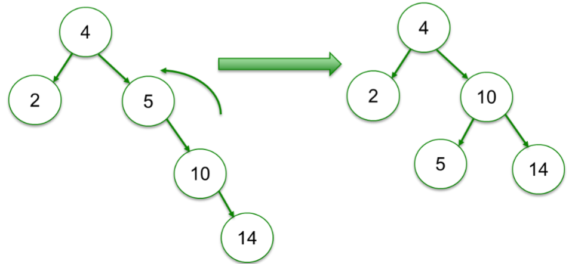
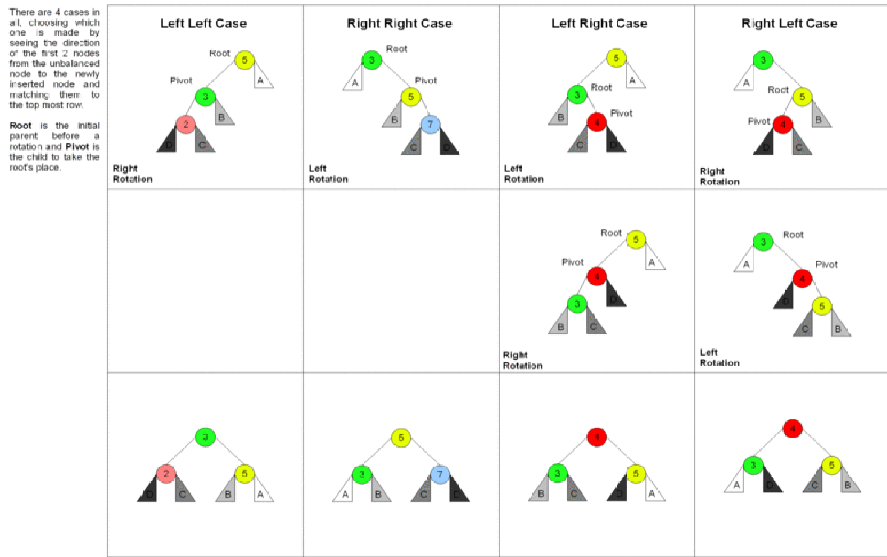

# TREES
## Definitions
A tree is a data structure made of nodes, where each node contains a value and references to its children.

***Root***: The top node of the tree. <br>

***Siblings***: Nodes with the same parent.<br>

***Leaf***: A node that has no children.<br>

***Path***: A sequence of nodes from a node n1 to a descendant nk.<br>

***Depth of a node***: is the length of the path from the root to that node.<br>

***Height of a node***: is the length (number of edges) of the longest path from that node to a leaf. The **height of a tree** is the height of its root.<br>

***Size of a node***: is the number of desendants the node has, including iteslf. The **size of a tree** is the size of its root.<br>

## Properties
- A tree with n nodes has n-1 edges. <br>
- A tree has no cycles. <br>
- A tree has exactly one path between any two nodes. <br>

Each node has the following structure:
```c++
class Node {
    typename value;
    Node* left;
    Node* right;
};
```
### Tree traversal
- ***Pre-order***: Node, left, right.
```c++
void PreOrder(Node node){
    if (node != nullptr){
        print(node.val);
        PreOrder(node.left);
        PreOrder (node.right);
    }
}
```
- ***In-order***: Left, node, right.
```c++
void Inorder(Node node){
    if (node != nullptr){
        Inorder(node.left);
        print(node.val);
        Inorder (node.right);
    }
}
```
- ***Post-order***: left, right, node.
```c++
void PostOrder(Node node){
    if (node != nullptr){
        PostOrder(node.left);
        PostOrder (node.right);
        print(node.val);
    }
}
```

## Binary Search Trees - BST
- Each node has 0, 1 or 2 children
- Child with smaller value than the parent is to the left
- Child with greater value is to the right.

To search for a value in a binary search tree:
- Start from root node, if value is less than root, go to left subtree, else go to right subtree. Repeat until value is found or reach a leaf node.

The depth of the tree determines performance. 
> A balanced tree has a depth of $O(log n)$, while an unbalanced tree can have a depth of $O(n)$.

### Operations on BST
***FindMin***:
```c++
void findMin(Node* root){
    Node* temp = root;
    while (temp->left != nullptr) temp = temp->left;
    cout << endl << temp->key << " is the min value.\n";
}
```
***FindMax***:
```c++
void findMax(){
    Node* temp = root;
    while (temp->right != nullptr) temp = temp->right;
    cout << endl << temp->key << " is the max value.\n";
}
```
- ***Insert***: Always add new elements at nullptr.
```c++
void insert(Node root){

}
```
- ***Contains***: Check for x in tree.
```c++
void contains(Node root, x){ //Start from root

}
```
***Remove***: Remove a value x from the tree:
Three cases:
1. The node x has not children
    - Simply replace it with null
2. The node x has 1 child
    - Replace with the child.
3. Node has two 2 children
    - Find and replace with the min child of the right subtree

>All the methods above traverse down along only one path of the tree, proportional to the height of tree.
>- If tree is balanced and its height is $log N$, all methods take $O(log N)$

## AVL TREES
Unbalanced trees may end up with $O(n)$ time complexity.

To combat this, for each node, also keep track of the height of its subtrees. 

Balancing is done by rotating the specific node when height differences get too large.


- Single rotation: a node and a child
- two single rotations

In an AVL tree, for each node, the height of the left and right subtrees never differs more than 1 (balance factor).


### Insertion
- Case 1: an insertion in the left subtree of the left child of X
- Case 2: an insertion in the right subtree of the left child of X
- Case 3: an insertion in the left subtree of the right child of X
- Case 4: an insertion in the right subtree of the right child of X

After insertion, check each node for consistency with AVL rules.

- Cases ***1 and 4*** can be fixed by ***single*** rotation.
- Cases ***2 and 3*** can be fixed by ***double*** rotation.


