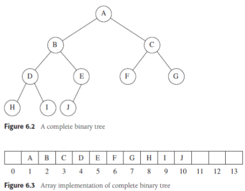
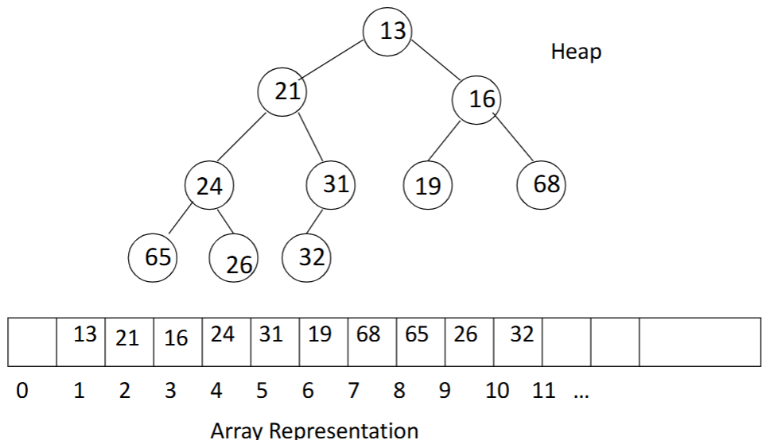

# PRIORITY QUEUE (HEAP)
An abstract data structure like queue or stack but each element has a priority. Elements with highest priority are pulled first.

## Operations
- **Insert**: Similar to enqueue.
> **Delete**: done based on priority, always removes the min element.

## Implement a priority queue
### 1. By linked list
- Insertion take $O(1)$ when position is known.
- Delete takes $O(n)$  
### 2. By Sorted Linked list
- Insertion take $O(n)$, need to find place to insert.
- Delete takes $O(1)$, delete the first element.
### 3. By Binary search tree.
- Insertion and delete take $O(log N)$
## 4. By Binary Heap
A heap is a completely filled binary tree, more items added at bottom level from left to right.
- implemented as array, drawn as tree.

### Heap Structure Property
Gives rules while building the heap.

For an element at index **k**, its ;
- left child is at index ***2k***
- Right child is at index ***2k + 1***
- Parent of the element is at index ***k/2***

### Heap Order Property - MinHeap
Gives for placing items in the heap

- Key in the child >= key in the parent. This order means that min values of the heap always the root.

MinHeap and its array rep:

> MaxHeap: Opposite, max key is the root.

### Insert operation of heap
Suppose ***insert(14)*** is called on the above heap
To correctly place it in the heap without violating heap order;
- Place it at end of array (ie i = 11)
- Find the parent using int division k/2 -> 11/ 2 = 5
- Compare the parent with the element, swap if parent is higher.

**Worst case**: for each level of the tree - $O(log N)$

**Average case**: $O(1)$ as most of the heap's items are in bottom two level and new item will likely only move a few levels up to maintain heap order.

The comparing and swapping done when inserting a new item is called ***Heapify-up***.

### Delete operation
Since it removes the root, a hole is left that must be percolated down to the end of the array.

## Building a heap
- Algo 1: Successive insertion
Insert items one at a time. N items to insert, each insert takes $O(log N)$. Therefore Algo 1 has $O(N log N)$

- Algo 2: Randomly insert the items in a binary tree-
    - copy all items into heap array, 
    - Call percolateDown() on all internal nodes.
    - Has $O(N)$ run time.

