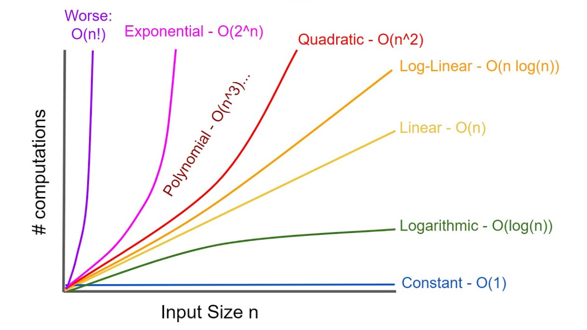
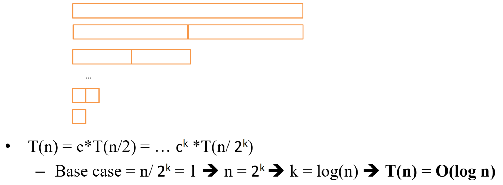
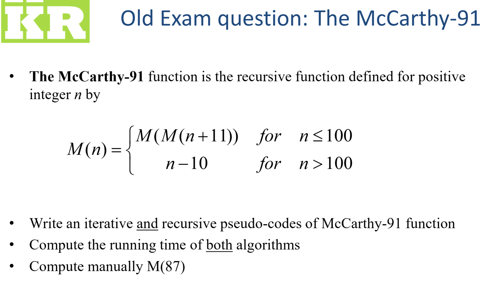
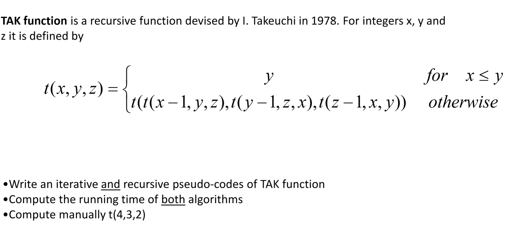
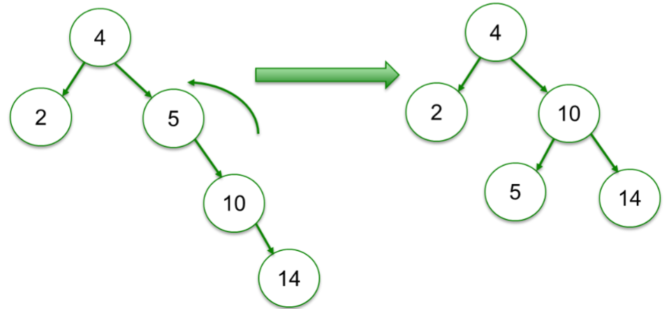

# Short on Big O Notation
Describes how runtime of an algorithm grows as input size N increases
- Ignore constants
- Ignore lower order terms

O(1) - Constant time, time doesn't depend on N size.

O(log N) - Logarithmic growth

O(N) - Linear time, increases with N size

O(N^2) - quadratic growth

O(N log N)

# RECURSION
A recursive function is a function that calls itself. 
Each call saves a activation record on the stack. When function returns, the AR is popped from stack.
Rules:
1. **Base case** - That can be solved without recursion, to eventually break the recursive chain
2. **Progress** - The cases to be solved must recursively move to the base case.
3. **Assume** all recursive calls work.
4. **Never duplicate** work by solving same instance in separate recursive calls

## Benefits of recursion
- Easy to describe and implement recursive solutions

## Drawbacks of recursion
- Many invocations can cause the stack to overflow
 > **Solutions**: Save the values in array, previous calculations are just got from there, O(N) time
- Some calculations are done multiple times

## Divide and Conquer
Break down a problem into smaller problems that are handled, their results are used to solve the bigger problem.
- How many times a segment be divided in halves till a segment of size 1.

- The ***division*** has time complexity **T(N) = O(log N)**.

- ***Conquer*** means traversing all elements on each level. If each level has N elements, traversing all the levels takes N * log N
Therefore this kind has **T(N) = O(N log N)**.

>> ***Note***: Iterative versions of recursive functions can be more efficient.

# ***To-do***
- Hand to hand with Hanoi tower
- Theory times for recursive functions
- 
- 
- 

