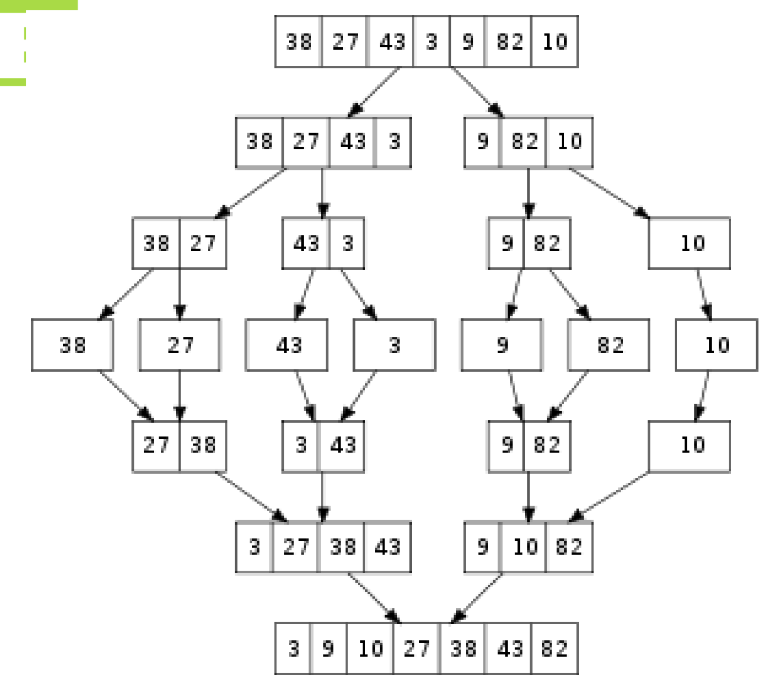
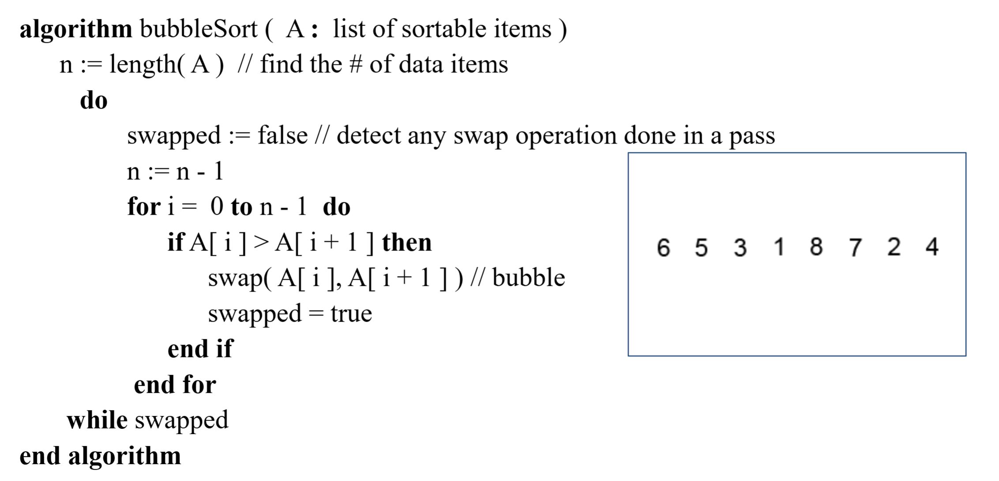
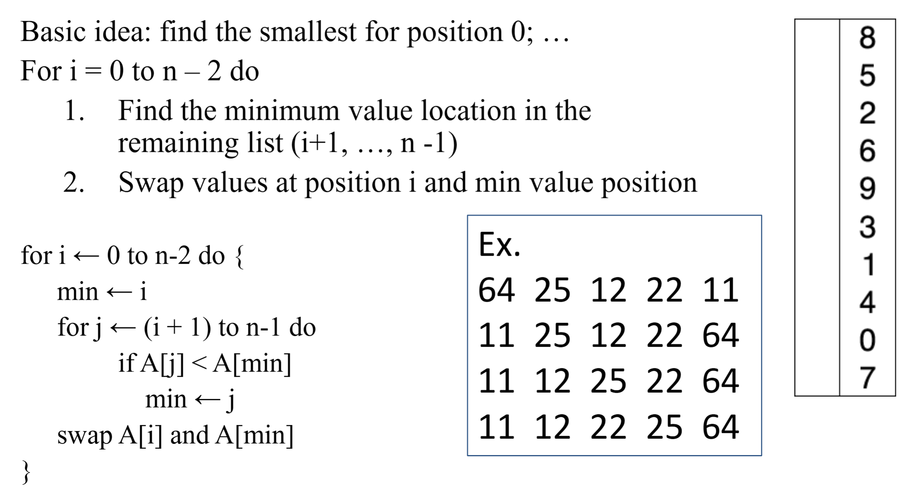
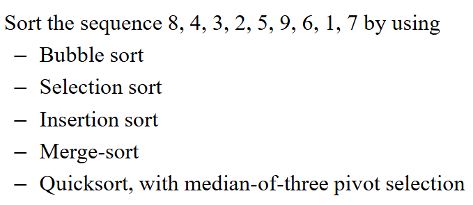

# **Searching Algorithms**

## Linear search - O(N)
- Used for unsorted arrays. Checks all elements in array until searched is found. 
- Therefore time complexity **T(N) = O(N)**.
- Not suitable for large data

## Binary search - O(log N)
- Used on sorted array
- Each time the problem is reduced in half of the previous
- Runs in **T(N) = O(log N)**.

# **Sorting Algorithms**

## Insertion sort - O(N^2) [Insertion link](https://www.youtube.com/watch?v=ROalU379l3U)
- Given a sorted part of array, insert a new element to be sorted, Repeat insertion till all are sorted.

>> Efficient for small inputs and if elements are already or nearly sorted.

- Best case: **O(N)** if already sorted, because inner loop takes O(1) and outer loops runs O(N).
- Average/worst case: **O(N^2)** - worst when array sorted in reverse

## Quick sort - O(N log N)
> - Pick an element, a pivot. 
> - Rearrange so that all elements less than come before it
> - Greater elements come after it.
> - Equal elements can go either way. After this, The pivot is in its final position.
> - Recursively apply the above steps to the sub array of elements with smaller values and separately to the sub array of elements with greater values.

-  Fast divide and conquer
- Best/Average case:  ***O(N log N)***
- Worst case: **O(N^2)** when smallest or largest element is always chosen as pivot. This can be avoided by choosing the pivot randomly.

### First/last element as pivot
- ***Pro***: Easy to implement

- ***con***: Works well if array is random. Worst case when array is already sorted or reverse sorted, O(N^2)

### Random element as pivot
- ***Pro***: Works well for random arrays, and avoids worst case when array is already sorted or reverse sorted.

- ***Con***: More complex to implement, and may not perform well if array has many duplicate elements.

### Median as pivot
- ***Pro***: Provides good performance even for sorted or reverse sorted arrays, as it consistently chooses a pivot that is close to the middle of the array.

- ***Con***: Finding the median can be computationally expensive, especially for large arrays, which can negate the performance benefits of using it as a pivot.

## Merge sort - O(N log N) [Merge sort](https://www.youtube.com/watch?v=XaqR3G_NVoo)

> - Based on the divide and conquer technique.
> - If array length is 0 or 1, array is sorted.
> - Else divide array into sub arrays to be sorted recursive using mergesort. Finally join the sub arrays.

- Dividing up the array takes log N, when all elements are in own list, comparing them to merge take N -----> ***N log N*** time
- worst run time of N log N.
E.g. 

## Bubble sort - O(N^2): [Bubble link](https://www.youtube.com/watch?v=lyZQPjUT5B4)
- Repeatedly step through the list, compare and swap two elements if they're in wrong order.

>> Best case run time O(N) when array is already sorted
- Worst case when array is sorted in reverse order
- Worst and average case run in **O(N^2)**
- Not suitable for large amount.

## Selection sort - O(N^2): [Selection link](https://www.youtube.com/watch?v=lyZQPjUT5B4)
- Divide the list into sub arrays, already sorted on the left and those to be sorted in the remainder of the array.

- Best, average and worst case time of **O(N^2)**.

#### For more searching algorithms, see [Searching Algorithms](https://www.geeksforgeeks.org/searching-algorithms/)
#### For more sorting algorithms, see [Sorting Algorithms](https://www.geeksforgeeks.org/sorting-algorithms/)

# ***To-do***

