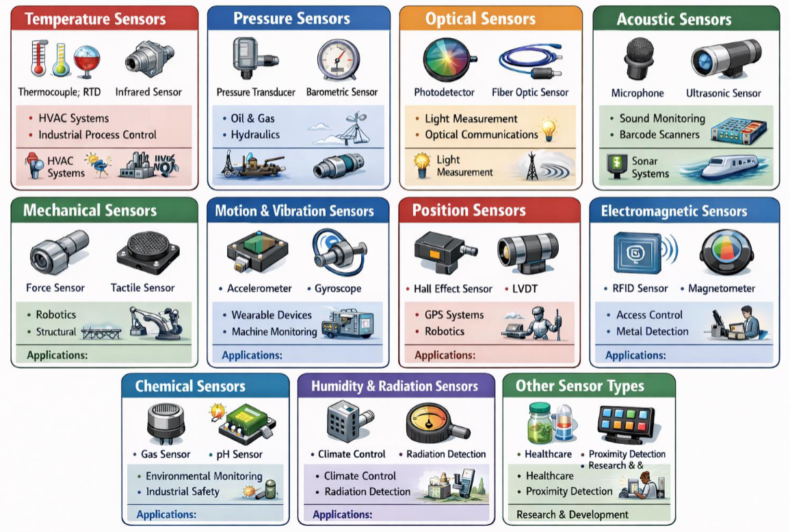
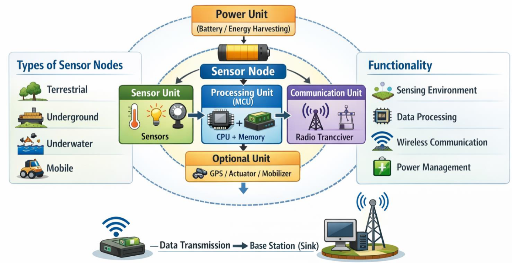
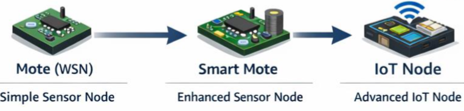

# LECTURE 1: Fundamentals of WSNs

- **ADC**: Converts analog signals to digital.
- **DAC**: From digital to analog. Often connected to actuator controlling something in the real world.

- **Sensor**: Collects information/data from physical world.
    - Converts one form of energy from physical world to electrical signal.
        - Thermistor (temperature) 
        - Light sensor
        - Gas sensor
        - Motion sensor

-  **Transducer**: physical energy - electrical or vice versa.
    - All sensors are transducers, not all transducers are sensors.
        - microphone
        - speaker
- **Actuator**: Electrical to mechanical  e.g. motor.

- **Signal conditioning**: Prepare a signal for further use.
    - Amplification
    - Attenuation: Reduction in signal strength over distance or through different mediums.
    - Filtering unwanted signals

- **Sink**: The base station where sensor node sends the data.

- **Mote**: simple sensor node. A small, low-power, autonomous sensor node in WSN that integrates sensing, computation and short-range wireless communication to collect and transmit environmental data cooperatively.
    - Traditional WSN
    - Basic sensing
    - Short range radio
    - Battery powered

- **Sensor node**: A small, low-power electronic device used in WSN to sense, process and wirelessly transmit data from environment to base station. e.g. temp, humidity, pressure, motion.
    - Advanced sensors, multiple motes
    - Edge processing
    - Internet connected
    - Enhanced security

## ***WSN Communication***

### **Star topology (Single hop)**
 Every sensor sends data directly to sink.
- Large energy consumption for large geographic areas.

### **Mesh topology (Multi-hop)**
 Sensors act as relays for other sensor nodes.
- Lower power consumption, larger coverage.
- Needs proper routing. 

## Challenges in WSNs
- Energy: how to power the sensors.
    - Sensors usually battery powered, need replacing.
    - For non-rechargeable battery sensors, they must operate during entire lifetime

- Wirelsess Networks
    - Attenuation - Limits radio range
    - Multi-hop comm - increased latency, failure probability, complicated by use of duty cycle.
- Decentralization: For large scale coverage, using routing. May be less optimal than centralized networks.

- Design constraints: Hardware and software limitations
    - Low processing speed
    - Low storage
    - lack of i/o components e.g. GPS receivers
- Self management: e.g.
    - configure node parameters
    - initiate sensing responsibility
    - discover routes to sink
    - unattended operation - adapts to changes in topology, density, traffic load
    - adapts in response to failure
- Security: Monitoring critical infrastructural and sensitive data makes WSNs targets for attacks.
    - Recquire lightweight security solutions for encryption.

## Ubiquitous Computing in WSNs
Refers to embedding large numbers of intelligent, low-power sensor nodes
seamlessly into the physical environment so that sensing, communication, and computation occur continuously, context-aware, and invisible to users

