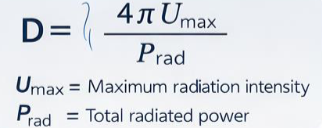
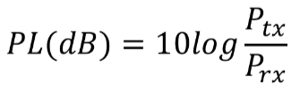
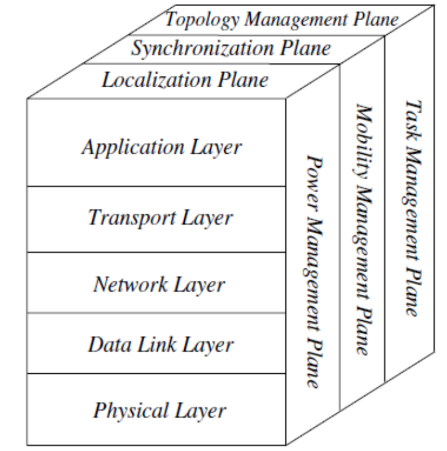

# WSN Protocol stack and Algorithms
> The radio spectrum is the range of electromagnetic frequencies used for wireless communication.

## Signal Propagation
> The way radio signals are transmitted from one point to another.
Radio signals are electromagnetic signals and are affected by:
- Reflection: Change of direction by bouncing off barrier.
- Refraction: Changing dir by bending as signal changes mediums
- Diffraction: Ch. dir as wave passes through opening or around barrier.
- Absorption: Signal is absorbed by material 
- Scattering: Wave is dispersed in different directions eg. dust in atmosphere
- Polarization: Orientation of the electric field of signal as it travels

## Modes of propagation
> Propagation dictates the behaviour of a transmitted signal.

# Wireless Links - Signal Propagation
- ***Propagation models***: Predict average received signal strength at a given distance from transmitter.
- ***Large scale path-loss***: Estimating signal strength vs distance.
- ***Small-scale/fading***: Variations over short distances, time and frequencies.

Transmission range depends on:
- Gain
- Transmission power
- Sensitivity of receiver
- Frequency of the signal; Lower freq, longer range.

## Antenna
Device to convert electrical energy into electromagnetic waves for transmission, and vice versa on receiver.

> Antenna Gain = n D. where n is radition efficiency, D is ***directivity*** (Ability of antenna to focus energy in a specific direction).
> 

## Large scale path-loss
The theoretical model is the free space model.
- Path-loss: Difference in dB between the Tx and Rx power.

## Small scale/Fading
Due to same signal arriving at antenna at different times because of propagation behaviour e.g. reflection, scattering etc.
- Delay spread: Duration of echo generated by the different arrival times.

## Protocol Stack model for WSN

- ***Physiscal*** layer: (de)Modulation, spectrum allocation, transmission and reception. 
- ***Datalink*** layer: Error control techniques for reliable comm through MAC sublayer.
- ***Network*** layer:  Energy aware data routing.
- ***Transport*** layer: Data flow maintenace

---

- ***Power*** management: monitoring available energy level and allocate resources accordingly.
- ***Mobility*** management: Detects and registers the movement of sensor node
- ***Task*** management: balances and schedules the sensing tasks given to a region.

- ***Localization*** plane: Accurate view of the observed sensor field
- ***Synchronization*** plane: Local clock for sensing, processing and communication.
- ***Topology*** plane:Connectivity and coverage, formation of clusters
